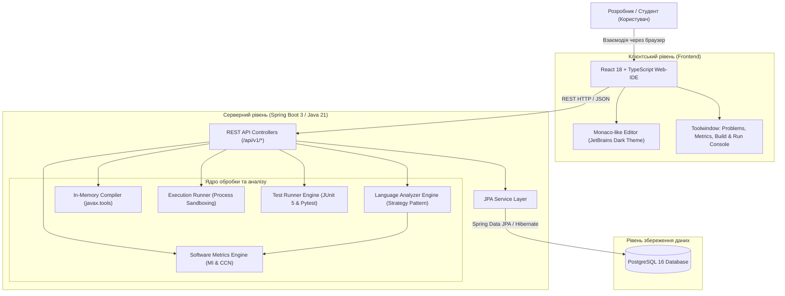
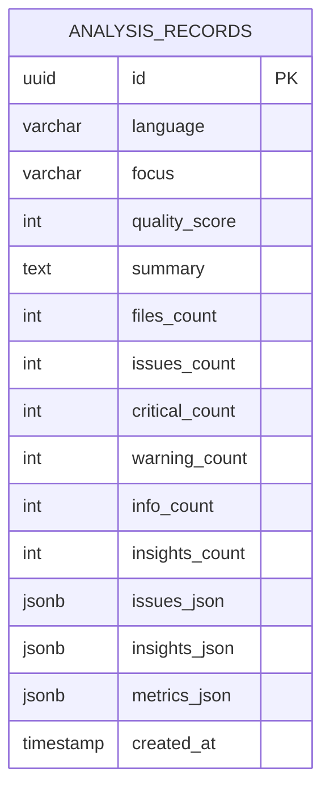

# Архітектура програмної системи Smart Code Analyzer

## 1. Загальний огляд системи

**Smart Code Analyzer** — це інтегрований вебзастосунок для автоматизованого статичного аналізу архітектури, розрахунку метрик якості програмного забезпечення, компіляції вихідного коду, безпечного виконання та генерації модульних тестів.

---

## 2. Діаграма архітектури системи (C4 Container Diagram)

---

## 3. Діаграма сутностей бази даних (Entity-Relationship Diagram)

---

## 4. Патерни проектування, використані в системі

1. **Strategy Pattern (Патерн «Стратегія»)**:
   - Інтерфейс `LanguageAnalyzer` реалізований окремими класами: `JavaCodeAnalyzer`, `PythonCodeAnalyzer`, `TypeScriptCodeAnalyzer`, `JavaScriptCodeAnalyzer`.
   - Інтерфейс `CodeCompiler`: `JavaCodeCompiler`, `PythonCodeCompiler`, `TypeScriptJavaScriptCompiler`.
   - Інтерфейс `CodeRunner`: `JavaCodeRunner`, `PythonCodeRunner`, `JavaScriptTypeScriptRunner`.
   - Інтерфейс `TestRunner`: `JavaTestRunner`, `PythonTestRunner`, `JavaScriptTypeScriptTestRunner`.
2. **DTO (Data Transfer Object)**:
   - Повна ізоляція внутрішніх моделей від API контракту за допомогою Java Records (`AnalysisRequestDto`, `AnalysisResponseDto`, `CompilationRequestDto`, `ExecutionRequestDto`, `TestExecutionRequestDto`).
3. **Repository Pattern**:
   - `AnalysisRecordRepository` розширює `JpaRepository` для абстрагування доступу до PostgreSQL.
4. **Dependency Injection & Inversion of Control**:
   - Автоматичне виявлення та ін'єкція списків стратегій (`List<LanguageAnalyzer>`, `List<CodeCompiler>`, `List<CodeRunner>`, `List<TestRunner>`) через Spring Framework.

---

## 5. Методологія розрахунку метрик підтримуваності

Система використовує адаптовану формулу **SEI Maintainability Index**:

$$MI = \max\left(0, \frac{171 - 5.2 \cdot \ln(V) - 0.23 \cdot G - 16.2 \cdot \ln(LOC) + 50 \cdot \sin(\sqrt{2.4 \cdot CR})}{171}\right) \cdot 100$$

де:
* $V$ — Об'єм за Холстедом (Halstead Volume)
* $G$ — Цикломатична складність за Маккейбом (Cyclomatic Complexity)
* $LOC$ — Рядки вихідного коду (Lines of Code)
* $CR$ — Коефіцієнт коментування (Comment Ratio)

### Шкала рейтингів:
* **Рейтинг A (MI ≥ 85)**: Відмінна підтримуваність коду.
* **Рейтинг B (65 ≤ MI < 85)**: Хороша якість, помірний ризик.
* **Рейтинг C (50 ≤ MI < 65)**: Посередня якість, рекомендовано рефакторинг.
* **Рейтинг D (MI < 50)**: Висока технічна заборгованість, критична необхідність рефакторингу.
